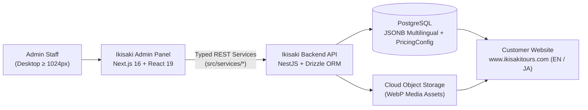

<div align="center">


<h1>Ikisaki Tours — Admin Panel</h1>

<p>
  <strong>Centralized Operations, Multilingual CMS &amp; Dynamic Pricing Dashboard for <a href="https://www.ikisakitours.com">www.ikisakitours.com</a></strong>
</p>

<p>
  <a href="https://nextjs.org/"></a>
  <a href="https://react.dev/"></a>
  <a href="https://www.typescriptlang.org/"></a>
  <br />
  <a href="https://tailwindcss.com/"></a>
  <a href="https://vercel.com/"></a>
</p>

<p>
  <a href="https://ikisakitours-admin-panel.vercel.app">Live Admin Panel</a> ·
  <a href="https://ikisakitours-admin-panel.vercel.app/manual">In-App Manual (<code>/manual</code>)</a> ·
  <a href="./admin-panel/ADMIN_MANUAL.md">Admin Operations Manual</a> ·
  <a href="./admin-panel/public/sample-packages">Sample JSON Templates</a>
</p>

</div>

---

## Table of Contents

- [Overview](#overview)
- [System Architecture](#system-architecture)
- [Module Directory (All 12 Groups)](#module-directory-all-12-groups)
- [Core Engineering Highlights](#core-engineering-highlights)
  - [1. Unified Dynamic Group Pricing (`pricingConfig`)](#1-unified-dynamic-group-pricing-pricingconfig)
  - [2. Multilingual `JSONB` CMS & Gold Title Highlighting](#2-multilingual-jsonb-cms--gold-title-highlighting)
  - [3. Strict WebP Media Pipeline & Brand Assets](#3-strict-webp-media-pipeline--brand-assets)
  - [4. Interactive In-App Operations Manual (`/manual`)](#4-interactive-in-app-operations-manual-manual)
  - [5. Enterprise Zero-Trust Admin Authentication, 10-Role RBAC & 2FA Engine](#5-enterprise-zero-trust-admin-authentication-10-role-rbac--2fa-engine)
  - [6. Dual-Lock Route Guard, Zero-Flash Protection & Cloudflare R2 WebP Profile Engine](#6-dual-lock-route-guard-zero-flash-protection--cloudflare-r2-webp-profile-engine)
  - [7. Customer Account Suspension & Zero-Trust Access Guard](#7-customer-account-suspension--zero-trust-access-guard)
  - [8. Branded Entity Reference ID Engine, HoverScrollText Component & UI/UX Resilience](#8-branded-entity-reference-id-engine-hoverscrolltext-component--uiux-resilience)
  - [9. Session Timeout Interceptor, 401 Recovery & Cloudflare R2 Asset Lifecycle](#9-session-timeout-interceptor-401-recovery--cloudflare-r2-asset-lifecycle)
  - [10. PDF Itinerary Studio & Word Hub (`/itinerary-editor`)](#10-pdf-itinerary-studio--word-hub-itinerary-editor)
- [API Service Layer Reference](#api-service-layer-reference)
- [Tech Stack](#tech-stack)
- [Project Structure](#project-structure)
- [Getting Started](#getting-started)
  - [1. Clone & Install](#1-clone--install)
  - [2. Configure Environment Variables](#2-configure-environment-variables)
  - [3. Run, Type-Check & Build](#3-run-type-check--build)
  - [4. Backend Super Admin Seeding (`npm run seed:admin`)](#4-backend-super-admin-seeding-npm-run-seedadmin)
- [Deployment (Vercel)](#deployment-vercel)
- [Production Readiness Checklist](#production-readiness-checklist)
- [Credits & License](#credits--license)

---

## Overview

The **Ikisaki Tours Admin Panel** is a desktop-first enterprise operations platform powering **Ikisaki Tours** — a luxury Sri Lanka private tour operator serving international travelers with native **English (`EN`)** and **Japanese (`JA`)** localization plus extensible multi-language support.

From one centralized workspace, administrators manage fixed tour packages, industry-standard group discount tiers, passenger category rules, tour add-ons, day-by-day itineraries with dynamic meals & hotels, reusable destinations, customer bookings, custom service requests, registered user VIP/access controls, date availability calendars, blogs, FAQs, review moderation & admin replies, WebP media assets, legal compliance documents, and internal operations logs.

> [!TIP]
> **New to the dashboard?** Open the built-in interactive **[Admin Manual Guide (`/manual`)](https://ikisakitours-admin-panel.vercel.app/manual)** from the left sidebar, or read **[`admin-panel/ADMIN_MANUAL.md`](./admin-panel/ADMIN_MANUAL.md)** for step-by-step operational guides.

> [!IMPORTANT]
> **Desktop-Only Guardrail:** Complex pricing grids, multi-day itinerary builders, and calendar controls are protected by `DesktopOnlyGuard`. Always operate on a PC or laptop viewport (`≥ 1024px` recommended).

---

## System Architecture



---

## Module Directory (All 12 Groups)

| Group                       | Route(s)                                                                | Operational Capabilities                                                                                                                                                                                                                                                                                                                                      |
| :-------------------------- | :---------------------------------------------------------------------- | :------------------------------------------------------------------------------------------------------------------------------------------------------------------------------------------------------------------------------------------------------------------------------------------------------------------------------------------------------------ |
| **Authentication & Access** | `/login`                                                                | Zero Trust executive login portal with 256-bit encrypted session handling, Edge Middleware route protection, and instant sidebar Sign Out                                                                                                                                                                                                                     |
| **Staff & Team (RBAC)**     | `/staff`                                                                | 10-role internal staff directory, role provisioning, status toggles (Active/Suspended) with immediate session invalidation, temporary password resets, and 2FA compliance tracking                                                                                                                                                                            |
| **Overview**                | `/dashboard`                                                            | Monthly KPI cards (Visitors, Feed Impressions, Total Clicks, Avg. SEO Rank) + interactive Recharts `GrowthChart`                                                                                                                                                                                                                                              |
| **Bookings & Operations**   | `/tours`, `/tourservices`, `/itinerary-editor`                          | One-Day / Multi-Day package booking statuses (`Pending`, `Confirmed`, `Completed`, `Cancelled`); tabbed service inquiries (`Custom Made Tours`, `Private Chauffeur`, `Transfers`); plus **PDF Itinerary Studio** for A4 print-ready Word vouchers & Japanese agency (HIS) standard travel itineraries with EN/JA dual-language engine and local draft storage |
| **User Management**         | `/users`                                                                | Customer directory with total count badge and live **VIP**, **Active Access**, and **Verified** status toggles                                                                                                                                                                                                                                                |
| **Tour Packages**           | `/addpackage`, `/managepackages`                                        | EN/JA/+ tour builder, 1-click JSON prefill, 18 conversion badges, Title + Gold Highlight rules, dynamic group pricing tiers, passenger rules, add-ons, dynamic meals/accommodation lists, Live Pricing Simulator, text-only `PATCH` inline editing, and 1-click Live Visibility toggle                                                                        |
| **Destinations**            | `/destinations`, `/managedestinations`, `/managedestinations/[id]/edit` | Reusable Sri Lanka destination hubs with JSON uploader, quick facts, multilingual content, 1-click Live Visibility, and isolated edit mode (`hideImageUpload`)                                                                                                                                                                                                |
| **Blog Articles**           | `/blogs`, `/manageblogs`, `/manageblogs/[id]/edit`                      | Multilingual travel blog CMS with JSON importer, auto-slugify + custom slug override, 1-click Live Visibility toggle, and isolated edit mode (`hideImageUpload`)                                                                                                                                                                                              |
| **FAQs & Help**             | `/faqs`, `/managefaqs`, `/managefaqs/[id]/edit`                         | Localized English & Japanese customer support Q&A management with 1-click Live Visibility toggle                                                                                                                                                                                                                                                              |
| **Availability & Rates**    | `/newupdates`, `/servicepricing`, `/servicenotes`                       | Closed-date monthly calendar with tour-type closures & multilingual notes; 3-tab service pricing (`Charter`, `Custom`, `Transfer`); vehicle specs & multilingual service guidelines                                                                                                                                                                           |
| **Media & Engagement**      | `/imageupload`, `/comments`, `/contact`                                 | Strict `.webp` batch uploader (max 4/batch); unified Website Feedback + Package Reviews moderation (visibility toggle + direct **Admin Replies**); Contact Us inquiry inbox                                                                                                                                                                                   |
| **Compliance & System**     | `/legaldocs`, `/adminlogs`                                              | Multilingual structured Legal Document CMS (Privacy Policy, Terms, sections & sub-items) and internal Admin Operations Log                                                                                                                                                                                                                                    |
| **Help & Guide**            | `/manual`                                                               | Modular, searchable in-app Admin Manual Guide with 1-click sample JSON downloads, interactive Pre-Publish Checklist, and Troubleshooting Accordion                                                                                                                                                                                                            |

---

## Core Engineering Highlights

### 1. Unified Dynamic Group Pricing (`pricingConfig`)

Tour pricing aligns with real Sri Lanka private vehicle capacities and room-sharing economics:

| Tier                         | Min Pax | Max Pax | Sri Lanka Vehicle Class                |
| :--------------------------- | :-----: | :-----: | :------------------------------------- |
| **Solo**                     |   `1`   |   `1`   | Sedan Car (Prius / Axio)               |
| **Couple**                   |   `2`   |   `2`   | Sedan Car (1 Double/Twin Room)         |
| **Small Group**              |   `3`   |   `4`   | Flat-Roof Van / Mini-Van (KDH / Noah)  |
| **Medium Group**             |   `5`   |   `7`   | High-Roof Van (Toyota KDH High Roof)   |
| **Large Group**              |   `8`   |  `15`   | Mini Coach (Mitsubishi Rosa / Coaster) |
| **Coach Group** _(Optional)_ |  `16`   |  `30+`  | Full-Size Luxury Coach (33–45 Seater)  |

- **Passenger Rules**: Couple (`auto_tier` or `fixed`), Child (`percentage` e.g. `50%` or `fixed`), Infant (default `$0`).
- **Tour Add-Ons**: Multilingual optional extras supporting `per_person`, `per_room`, and `per_booking` (one-time flat fee) billing modes inside the customer Booking Review Modal.
- **Built-in Simulator**: Interactive calculator embedded inside `/addpackage` and `/managepackages` to verify final totals before publishing.

<details>
<summary><strong>View Complete <code>pricingConfig</code> JSONB Schema Example</strong></summary>

```json
{
  "tiers": [
    { "minPax": 1, "maxPax": 1, "pricePerPerson": 850, "label": "Solo (1 Person)" },
    { "minPax": 2, "maxPax": 2, "pricePerPerson": 580, "label": "Couple (2 Persons)" },
    { "minPax": 3, "maxPax": 4, "pricePerPerson": 460, "label": "Small Group (3-4 Persons)" },
    { "minPax": 5, "maxPax": 7, "pricePerPerson": 390, "label": "Medium Group (5-7 Persons)" },
    { "minPax": 8, "maxPax": 15, "pricePerPerson": 320, "label": "Large Group (8-15 Persons)" }
  ],
  "passengerPricing": {
    "couplePricingType": "auto_tier",
    "coupleFixedPrice": 1160,
    "childRateType": "percentage",
    "childRateValue": 50,
    "infantPrice": 0
  },
  "options": [
    {
      "id": "opt-single-supplement",
      "name": { "en": "Single Room Accommodation Supplement", "ja": "シングルルーム（一人部屋）確約追加代金" },
      "price": 180,
      "calculationType": "per_room"
    },
    {
      "id": "opt-first-class-train",
      "name": { "en": "Scenic Blue Train 1st Class Ticket Upgrade", "ja": "絶景高原列車 1等指定席アップグレード" },
      "price": 25,
      "calculationType": "per_person"
    },
    {
      "id": "opt-vip-vehicle-upgrade",
      "name": { "en": "VIP Luxury Vehicle Upgrade (Alphard / Mercedes)", "ja": "VIPラグジュアリー車両アップグレード" },
      "price": 150,
      "calculationType": "per_booking"
    }
  ]
}
```

</details>

### 2. Multilingual `JSONB` CMS & Gold Title Highlighting

- All customer-facing text fields (`title`, `titleEmphasis`, `leadTitle`, `leadDescription`, `description`, `highlights`, `includes`, `excludes`, `activityDetails`, `itinerary`, dynamic `meals[]` & `accommodation[]`, add-ons, blogs, FAQs, legal docs, and closed-date notes) store ISO locale dictionaries (`{ "en": "...", "ja": "..." }`) with live `+` custom language extensibility.
- **Clean URL Slug Generation**: Auto-generated strictly from **Package Title (`EN`)** — updating Highlighted Words (`titleEmphasis`) never alters the URL slug.

> [!WARNING]
> **Japanese Highlight Matching Rule:** The customer website matches `titleEmphasis` character-for-character inside `title`. In Japanese, always use the exact same script (Kanji vs Katakana) in both fields — e.g., Title `究極のスリランカ・グランドエクスプローラー` → Highlight `究極のスリランカ`.

### 3. Strict WebP Media Pipeline & Brand Assets

- **Media Gallery (`/imageupload`)**: Enforces strict `.webp` format validation and a maximum batch size of **4 images per upload** (`POST /uploads/batch`) for optimal web performance.
- **Metadata, OpenGraph & Twitter Cards**: Configured in [`admin-panel/src/app/layout.tsx`](./admin-panel/src/app/layout.tsx) using optimized WebP brand assets from [`admin-panel/public/Layout-Icons/`](./admin-panel/public/Layout-Icons):
  - `favicon.ico`, `image-200x200.webp`, `image-400x400.webp`, `image-600x600.webp` (Icons & Apple Touch)
  - `image-1200x630.webp` & `image-600x315.webp` (OpenGraph & Twitter `summary_large_image`)
  - `robots: { index: false, follow: false }` to keep internal admin routes excluded from public search engines.

### 4. Interactive In-App Operations Manual (`/manual`)

Built as a modular, data-driven documentation hub inside [`admin-panel/src/app/manual/`](./admin-panel/src/app/manual):

- Centralized typed content store (`data/manualMockData.ts`) powering 11 focused React components
- Live full-text search across all 13 sections + hashtag quick-filter chips
- Direct 1-click downloads for One-Day and Multi-Day sample JSON templates
- Interactive Pre-Publish Checklist with live progress bar + expandable Troubleshooting Accordion

### 5. Enterprise Zero-Trust Admin Authentication, 10-Role RBAC & 2FA Engine

The Ikisaki Tours Admin Panel implements an enterprise-grade Zero-Trust authentication architecture designed to prevent unauthorized access, credential theft, session hijacking, and brute-force attacks:

- **Next.js 16 Edge Route Guard (`src/proxy.ts` / `middleware.ts`)**: Every single administrative route (`/dashboard`, `/staff`, `/tours`, `/managepackages`, `/destinations`, `/blogs`, etc.) is intercepted at the Vercel edge. Unauthenticated requests are immediately halted and redirected to `/login?redirect=<target>` before any page renders.
- **Light Luxury Login Portal (`/login`)**: Redesigned with a crisp executive light aesthetic (`bg-slate-50`, polished white cards, `emerald-600` accent buttons, and 256-bit encryption indicators) matching the Ikisaki brand.
- **Enterprise 10-Role RBAC Architecture (`src/app/staff/data/staffRoles.ts`)**:
  1. `SUPER_ADMIN`: Executive Root / Owner — Full unrestricted platform access across all 12 modules, user provisioning, and audit logs.
  2. `OPERATIONS_MANAGER`: Tour Operations Director — Oversees bookings, logistics dispatch, chauffeur guidelines, and customer records.
  3. `PACKAGE_MANAGER`: Tour Package Lead — Full authoring and editing of tour packages, itineraries, tier pricing, and media.
  4. `DESTINATION_EXPERT`: Destination Specialist — Curates Sri Lanka travel destinations, province guides, and attractions.
  5. `CONTENT_EDITOR`: Multilingual Content Editor — Publishes SEO travel blogs, cultural articles, and localized FAQs.
  6. `BOOKING_AGENT`: Tour Booking Specialist — Manages package reservations, date availability calendars, and traveler counts.
  7. `TRANSPORT_COORDINATOR`: Transport & Fleet Manager — Manages private chauffeurs, vehicle specs, and transfer rates.
  8. `CUSTOMER_SUPPORT`: Customer Support Executive — Handles web contact inquiries, FAQs, and customer messages.
  9. `REVIEW_MODERATOR`: Guest Reviews Moderator — Moderates traveler reviews, toggles public visibility, and posts official admin replies.
  10. `LEGAL_COMPLIANCE`: Legal & Compliance Officer — Maintains terms, privacy policies, and security audit logs.
- **Two-Factor Authentication (2FA / TOTP) Engine**:
  - Implements the **RFC 6238** TOTP standard using Node.js native `crypto` for 100% serverless Vercel compatibility.
  - Compatible with **Google Authenticator**, **Authy**, and 1Password via standard `otpauth://` QR codes.
  - Enforces a 2FA challenge at login: if enabled on the staff account, password verification yields `{ requiresTwoFactor: true }` and prompts for the live 6-digit TOTP code before granting access tokens.
- **Staff Lifecycle & Session Invalidation**:
  - Suspending an account (`is_active: false`) immediately revokes all active sessions for that user in `admin_sessions`.
  - Self-suspension and self-deletion safeguards prevent Super Admins from accidentally locking themselves out.
  - Super Admins can reset temporary passwords in 1 click, which automatically invalidates prior sessions.
- **Brute-Force & Lockout Defense**:
  - Tracks consecutive failed login attempts in the database (`failed_login_attempts`, `locked_until`).
  - On **5 consecutive incorrect attempts**, the account and IP are locked for **30 minutes** (returning `HTTP 429 Too Many Requests`).
- **Session Security & Dual-Token Rotation**:
  - Issues a 3-hour Access JWT and a 7-day cryptographically secure UUID Refresh Token.
  - Stored inside an `HttpOnly`, `Secure`, `SameSite=Strict` cookie (`admin_session`) — inaccessible to browser JavaScript, completely eliminating XSS token theft.
  - Automatic refresh token rotation: if a revoked refresh token is reused, all active sessions for that admin user are instantly invalidated.
- **Database Audit Logs (`admin_audit_logs`)**:
  - Automatically records timestamp, user ID, event type (`LOGIN_SUCCESS`, `LOGIN_FAILED`, `LOGOUT`, `STAFF_CREATED`, `2FA_ENABLED`), client IP address, and User-Agent for forensic review.
- **Supabase Row Level Security (RLS) Isolation**:
  - The tables `admin_users`, `admin_sessions`, and `admin_audit_logs` are protected with Row Level Security.
  - Public users using Supabase `anon` API keys are completely blocked (`403 Forbidden` / 0 rows).
  - Only the NestJS backend connecting via direct PostgreSQL pool credentials (`DATABASE_URL`) can read or write administrative tables.

### 6. Dual-Lock Route Guard, Zero-Flash Protection & Cloudflare R2 WebP Profile Engine

- **Global Route Interceptor (`AdminShell.tsx`)**:
  - Evaluates `isRoutePermitted(pathname, user.role)` before mounting `{children}`.
  - Eliminates the **Flash of Unauthorized Content (FOUC)**: Unauthorized page components are never mounted into the DOM, and their data-fetching API requests are never dispatched.
- **Unified Access Restricted Screen (`AdminAccessRestricted.tsx`)**:
  - Styled to match the Ikisaki Tours executive light luxury design system (`emerald-600`, `slate-900`, `amber-500`).
  - Displays the active staff role, target module name, authorized roles chip matrix, and a 1-click **Return to Dashboard** action.
- **Backend Route Protection (`RolesGuard`)**:
  - NestJS Controllers enforce `@UseGuards(AdminAuthGuard, RolesGuard)` and `@Roles(...)`.
  - Even if a client bypasses the frontend, the backend returns HTTP 403 Forbidden, keeping the database 100% secure.
- **Cloudflare R2 WebP Profile Photo Engine & Automatic Asset Cleanup**:
  - Photos uploaded in the Admin Profile modal are converted client-side to compressed `.webp` format before upload.
  - Avatar URLs include unique versioning timestamps to bust browser caches immediately upon replacement.
  - Automatic backend cleanup: When a new avatar photo replaces an existing one or when a staff member is deleted, the backend automatically issues an S3/R2 `DeleteObjectCommand`, removing old orphaned files from Cloudflare R2.

### 7. Customer Account Suspension & Zero-Trust Access Guard

- **Real-Time Database Verification (`JwtAuthGuard`)**:
  - Customer JWT session tokens contain only `{ sub: user.id }`.
  - On every incoming customer request, the NestJS `JwtAuthGuard` performs a real-time database lookup in PostgreSQL (`users` table).
  - If `hasAccess === false`, the guard immediately throws `403 Forbidden` with a standardized structured payload (`ACCOUNT_SUSPENDED`), invalidating access instantaneously without waiting for JWT token expiration.
- **Defense-in-Depth Mutation Protection**:
  - `POST /api/comments` & `POST /api/comments/package-review`: Blocked with 403 `ACCOUNT_SUSPENDED`.
  - `POST /api/package-bookings`: Rejected if caller or payload email matches a suspended account. Public guest bookings remain 100% operational.
  - `POST /api/services/*` (Transfer, Chauffeur, Custom tours): Inquiries from suspended accounts are blocked. Public guest inquiries remain 100% operational.
- **Customer Frontend Zero-Flash Lockout (`AccessGate.tsx`)**:
  - Root layout wraps the application with `<AccessGate>`, reading cached user status synchronously from Frame 0.
  - Suspended customers cannot view any protected pages (even for a millisecond); they are immediately locked onto the luxury `<AccessRestricted />` screen.
  - The **"SIGN OUT"** action purges auth cookies and local state, instantly restoring public guest browsing capabilities.

### 8. Branded Entity Reference ID Engine, HoverScrollText Component & UI/UX Resilience

- **Unified Entity Reference ID Architecture**:
  - Implements standardized, high-readability branded alphanumeric identifiers across all operational workflows:
    - **Customer Accounts (`/users`)**: `IKISAKI-XXXXXX` (e.g. `IKISAKI-8F42M9`, excluding confusing chars `0`, `O`, `1`, `I`).
    - **Package Tour Bookings (`/tours`)**: `IK-XXXXXXXX` (uses `bookingReference`).
    - **Tour Service Requests (`/tourservices`)**: `SRV-XXXXXXXX` (Custom tours, Chauffeur hire, Transfers).
    - **Contact Inquiries (`/contact`)**: `INQ-XXXXXXXX` (Direct customer inquiries).
    - **Reviews & Feedback (`/comments`)**: `REV-XXXXXXXX` (Package Reviews) / `FDB-XXXXXXXX` (Website Feedback).
    - **Support FAQs (`/managefaqs`)**: `FAQ-XXXXXX` (Categorized Q&A entries).
  - Enables instant 1-click clipboard copying, omni-search filtering by Reference ID, and rapid customer support issue tracking across email, WhatsApp, and phone channels.
- **Reusable Vercel-Style Hover Scroll Component (`HoverScrollText.tsx`)**:
  - **Default State**: Long multi-word table columns (Tour Package Names, Questions, Answers, Routes, Titles) are strictly clamped to a single line (`whitespace-nowrap overflow-hidden`). Eliminates awkward table column widening, layout warping, or messy multi-line breaks.
  - **On Hover ("Vercel Magic")**: When the user hovers their cursor over the text cell, an intelligent `useCallback` measures `scrollWidth - clientWidth`. If the text overflows its container, it smoothly pans horizontally (`translateX(-${overflowDistance}px)`) at a natural reading velocity (~45px/second, minimum 1.8s duration), revealing the entire content effortlessly.
  - **Mouse Leave Reset**: On mouse leave, the text smoothly glides back to its initial position (`0.3s transition`).
  - **Adaptive Guard**: If the text is short and fits within its container (`overflowDistance <= 0`), zero translation occurs and the cursor remains standard, incurring zero layout or animation overhead. Automatically recalculates on window resize events.
- **Dynamic Content-Adaptive Toast Engine (`AdminToast.tsx`)**:
  - Toast width adjusts dynamically according to message content (`w-auto max-w-[min(52rem,calc(100vw-3rem))]`) without forced fixed minimums or artificial width caps.
  - Standard messages under 95 characters remain strictly on a single line (`whitespace-nowrap max-sm:whitespace-normal`), preventing single-word line breaks (e.g. `code.`).
  - Maintains compact single-line height (`py-2`), standard crisp font scaling (`text-[11px] sm:text-xs font-semibold`), and dynamic display duration scaled to message length (4.5s to 10s).
- **Sidebar Isolated Smooth Navigation & Auto-Centering (`Sidebar.tsx`)**:
  - Container-scoped scrolling via `navRef.current.scrollTo(...)` strictly confines scroll animations to the sidebar navigation rail, preventing undesirable main document/window jumps.
  - **Bounded Nearest-Edge Auto-Scroll**: `scrollToActiveItem` uses smart nearest-edge scrolling (~16px margin) so bottom items like `Admin Manual Guide` rest naturally right at the visible guideline above the user card, avoiding aggressive overshooting to the upper 15%.
  - **Clean Bottom Spacing**: Streamlined bottom padding from an excessive 256px void (`pb-64`) down to a clean `pb-6` (24px) margin, ensuring the navigation seamlessly meets the profile card without empty dead space.
  - **Brand Header Direct Dashboard Link**: Clicking the brand icon badge (`IT`) or `IKISAKI TOURS Admin Panel` in the sidebar header instantly navigates to `/dashboard` across both collapsed and expanded states.
  - Hover auto-scroll (`onMouseEnter` with 180ms timing) automatically and gently glides the sidebar to the currently active page when expanding the collapsed navigation.
- **Admin Profile & Security Modal Ergonomics (`AdminSecurityModal.tsx`)**:
  - **Centered Content-Adaptive Toasts**: Profile, password, and 2FA feedback toasts dynamically scale to message length (`w-fit max-w-md mx-auto`), horizontally centered with backdrop blur, dismiss (`X`) button, and auto-dismiss after 4.5 seconds.
  - **Centered Manual Setup Key**: 2FA TOTP setup key is neatly centered with responsive horizontal scrolling (`w-fit max-w-full mx-auto`) and 1-click clipboard copy.
  - **Optimized Field Constraints**: All form inputs (`max-w-sm sm:max-w-[340px]`) prevent over-stretched text boxes on large monitors.
  - **High-Assurance 2FA Deactivation**: Turning off two-factor authentication strictly requires entering the administrator's current account password.
- **Login UX Resilience & 3-Hour Expiry Indicator (`login/page.tsx`)**:
  - Single-line concise session timeout banner (`"Session expired. Please sign in again."`) preventing awkward word wraps, truncation, or ellipses on smaller screens.
  - Footer indicator clearly displays `Session: 3-Hour Expiry` matching the NestJS backend JWT session duration.
- **Customer Two-Factor Authentication (2FA) Monitoring**:
  - The `/users` module monitors customer-side RFC 6238 TOTP adoption with real-time teal `2FA` badges across both table rows and responsive cards.

### 9. Session Timeout Interceptor, 401 Recovery & Cloudflare R2 Asset Lifecycle

- **Automatic 3-Hour Session Timeout & 401 Interception**:
  - Access JWT tokens remain valid for 3 hours of active administrative operations (`exp` timestamp verification).
  - Global API interceptors across `api-client.ts`, `auth.service.ts`, and `service-notes.service.ts` catch HTTP 401 Unauthorized responses and broadcast a central `admin:session-expired` event.
  - Replaces raw technical API error messages with an executive luxury security modal (`AdminSessionExpiredModal.tsx`).
- **Background Scroll Locking & Zero-Disruption Recovery**:
  - When the Session Expired modal opens, background page scrolling is locked (`document.body.style.overflow = "hidden"`), preventing disorientation while viewing administrative data.
  - Clicking **"Sign In Again"** automatically preserves the administrator's exact active pathname via query parameter (`/login?expired=true&redirect=<target>`).
  - Re-authenticating with email, password, and 2FA Authenticator code restores the session and seamlessly returns the administrator directly to their in-progress workspace.
- **Automatic Cloudflare R2 Orphaned Asset Cleanup**:
  - When a customer or admin replaces their profile avatar or deletes their account, the backend automatically resolves `targetToDelete` and asynchronously issues an S3/R2 `DeleteObjectCommand`.
  - External social avatars (Google `lh3.googleusercontent.com` and Facebook `graph.facebook.com`) are automatically identified and protected from deletion.
  - Keeps Cloudflare R2 bucket storage clean and eliminates orphan image storage costs without blocking HTTP responses.

### 10. PDF Itinerary Studio & Word Hub (`/itinerary-editor`)

- **Microsoft Word-Style Document Hub**:
  - Centralized document manager providing two streamlined entry pathways:
    - **Blank Document**: Clean-slate document creator with zero mock data, default remarks, and official Ikisaki branding.
    - **From Tour Booking**: 1-click import from confirmed client bookings (`/tours`) that auto-populates guest party names, room configurations (`1TWN`, `1DBL`, `1SGL`, `FAMILY`), flight schedules, tour dates, and destinations.
- **Two-Pane Live Studio Architecture**:
  - **Left Form Editor**: Manages Tour Metadata, dynamic Guest Party lists, Inbound/Outbound Flight tables, Day-by-Day schedule contents, Hotel check-ins, Meal indicators (`HOTEL`, `CLIENT`, `NONE`, `BOX MEAL`, `RESTAURANT`, `AIRPORT`), and Legal remarks.
  - **Right Live A4 Preview**: Built to exacting Japanese agency (HIS style) standards. Features bold table headers (`Date`, `Tour Content`, `Meals`), `font-normal` body typography, and strictly vertically aligned Meal indicators (`B - HOTEL`, `L - CLIENT`, `D - HOTEL`).
- **Activities & Scenic Stops Control with Trash Deletion & Restore**:
  - Each of **Activities**, **Scenic Stops & Viewpoints**, and **Tour Highlights & Notes** has an individual **Trash (`🗑️`)** icon on its label row to delete the section from any day.
  - Convenient restore buttons (`+ Add Activities`, `+ Add Scenic Stops`, `+ Add Tour Highlights`) appear at the bottom of the day card to bring any deleted section back in one click.
- **Dynamic Custom Sections Engine (`+ Add Custom Section`)**:
  - Administrators can add unlimited custom blocks per day with a **Section Title** and multi-line **Description/Notes** field, each equipped with its own Trash icon.
  - Every new line (`Enter` key or click) in the description automatically formats as a crisp, aligned bullet point (`• `) in the preview, matching Tour Highlights.
- **Dual-Language Engine (`EN` & `JA`) & Brand Protection**:
  - 1-click language switcher between **(EN)** English and **(JA)** Japanese. Form Editor labels remain in English for ease of admin operation.
  - Legal corporate entity name `Ikisaki Tours (Private) Limited` is strictly preserved in English even in Japanese vouchers.
  - Standardized official corporate contact info: `492/14, Halbarawa Road, Thalahena, Malabe, Sri Lanka`, direct operations phone `+94 75 797 2582`, and official email `info@ikisakitours.com`.
- **Offline-First Local Draft Storage**:
  - All drafts are auto-saved to browser `localStorage` (`ikisaki_itinerary_drafts`, `ikisaki_active_itinerary_draft`).
  - Drafts persist across browser closures and computer reboots, with zero backend API latency.
- **Architectural Distinction**:
  - _Package Itinerary Builder (`/addpackage` & `/managepackages`, Section 4.6)_: Configures public multilingual tour package listings stored in PostgreSQL.
  - _PDF Itinerary Studio (`/itinerary-editor`, Section 10)_: Produces customized, printable A4 guest travel vouchers stored in browser `localStorage`.

---

## API Service Layer Reference

All backend communication lives in strongly typed modules under [`admin-panel/src/services/`](./admin-panel/src/services):

| Service File                 | Primary Endpoint(s)                                                                 | Purpose                                                                                                             |
| :--------------------------- | :---------------------------------------------------------------------------------- | :------------------------------------------------------------------------------------------------------------------ |
| `auth.service.ts`            | `/api/admin/auth/login`, `/logout`, `/me`, `/profile`, `/change-password`, `/2fa/*` | Zero-Trust login, RFC 6238 2FA challenge, profile WebP updates, and password changes                                |
| `staff.service.ts`           | `/api/admin/staff`, `/api/admin/staff/:id/*`                                        | 10-Role Staff directory, onboarding, role updates, account suspension/session revocation, password reset & deletion |
| `package.service.ts`         | `/addpackages` (`GET`, `POST`, `PATCH`, `DELETE`)                                   | Create packages (`FormData` + images), fetch by slug, text-only updates                                             |
| `package-booking.service.ts` | `/package-bookings`, `/package-bookings/:id/status`                                 | List fixed tour bookings, update status, delete                                                                     |
| `tourservice.service.ts`     | `/services/custom`, `/services/chauffeur`, `/services/transfer`                     | Manage tailor-made tour, chauffeur & transfer requests                                                              |
| `destination.service.ts`     | `/destinations`, `/uploads/batch`                                                   | CRUD operations for Sri Lanka destination hubs                                                                      |
| `blog.service.ts`            | `/blogs`, `/uploads/batch`                                                          | Multilingual blog creation, editing & listing                                                                       |
| `faq.service.ts`             | `/faqs`, `/faqs/admin`                                                              | Multilingual FAQ CRUD management                                                                                    |
| `availability.service.ts`    | `/availability`                                                                     | Fetch & save closed booking dates and localized notes                                                               |
| `servicepricing.service.ts`  | `/service-pricing`                                                                  | Manage Charter, Custom Tour & Transfer rate cards                                                                   |
| `service-notes.service.ts`   | `/services/notes`                                                                   | Manage vehicle specs & multilingual service guidelines                                                              |
| `uploads.service.ts`         | `/uploads/batch`                                                                    | Batch upload up to 4 `.webp` images to storage                                                                      |
| `comments.service.ts`        | `/comments`, `/comments/:id/reply`, `/comments/:id/visibility`                      | Website feedback replies & visibility toggles                                                                       |
| `package-reviews.service.ts` | `/comments/package-reviews`, `/comments/package-review/:id/reply`                   | Package review replies & public visibility toggles                                                                  |
| `contact.service.ts`         | `/contacts`, `/contacts/:id`                                                        | Public Contact Us inquiry inbox & deletion                                                                          |
| `users.service.ts`           | `/auth/users`, `/auth/users/:id/status`                                             | Customer listing & VIP / Access / Verified toggles                                                                  |
| `legaldocs.service.ts`       | `/legal-docs`                                                                       | Multilingual Legal Document CMS CRUD                                                                                |

---

## Tech Stack

| Layer            | Technology                                                                    |
| :--------------- | :---------------------------------------------------------------------------- |
| **Framework**    | Next.js `16.2.10` (App Router, Turbopack, React Compiler)                     |
| **UI & Styling** | React `19.2`, Tailwind CSS `v4`, Shadcn / Base UI, Lucide React               |
| **Language**     | TypeScript `5.x`                                                              |
| **Charts**       | Recharts `3.8`                                                                |
| **Utilities**    | `exifr` (EXIF metadata), `clsx`, `tailwind-merge`, `class-variance-authority` |
| **Backend API**  | NestJS + Drizzle ORM + PostgreSQL (`NEXT_PUBLIC_API_URL`)                     |

---

## Project Structure

<details>
<summary><strong>Click to expand repository directory tree</strong></summary>

```text
Ikisakitours-Admin-Panel/
├── README.md                              # Root GitHub documentation (GFM)
├── LICENSE
└── admin-panel/                           # Next.js 16 application workspace
    ├── ADMIN_MANUAL.md                    # Printable operations handbook (GFM)
    ├── public/
    │   ├── Layout-Icons/                  # Favicon, OG & Twitter WebP brand assets
    │   └── sample-packages/               # Ready-to-import EN/JA JSON templates
    │       ├── sample-oneday-tour.json
    │       └── sample-multiday-tour.json
    ├── src/
    │   ├── app/
    │   │   ├── layout.tsx                 # Root layout, Google Fonts, OG/Twitter metadata
    │   │   ├── dashboard/                 # Analytics KPI cards & GrowthChart
    │   │   ├── staff/                     # 10-Role Staff Management & RBAC engine
    │   │   ├── tours/                     # Fixed One-Day & Multi-Day bookings
    │   │   ├── tourservices/              # Custom tours, chauffeur & transfer requests
    │   │   ├── users/                     # Customer directory & VIP/Access controls
    │   │   ├── addpackage/                # Package wizard (JSON, pricing, itinerary)
    │   │   ├── managepackages/            # Package table & inline PATCH editor
    │   │   ├── destinations/              # Destination creator (JSON + Quick Facts)
    │   │   ├── managedestinations/        # Destination list & [id]/edit route
    │   │   ├── blogs/ & manageblogs/      # Multilingual blog CMS & [id]/edit route
    │   │   ├── faqs/ & managefaqs/        # Multilingual FAQ CMS & [id]/edit route
    │   │   ├── newupdates/                # Date Availability calendar & closure notes
    │   │   ├── servicepricing/            # Charter, Custom & Transfer rate cards
    │   │   ├── servicenotes/              # Vehicle specs & service guidelines
    │   │   ├── imageupload/               # Strict .webp gallery uploader (max 4/batch)
    │   │   ├── comments/                  # Feedback + Package Reviews & Admin Replies
    │   │   ├── contact/                   # Contact Us inquiries inbox
    │   │   ├── legaldocs/                 # Multilingual Legal Document CMS
    │   │   ├── adminlogs/                 # Internal daily Operations Log
    │   │   └── manual/                    # Interactive in-app Admin Manual Guide
    │   │       ├── page.tsx
    │   │       ├── data/manualMockData.ts # Centralized guide content store
    │   │       └── components/            # 11 modular React guide components
    │   ├── components/                    # Sidebar, DesktopOnlyGuard, AdminShell, AdminAccessRestricted, Modals
    │   ├── lib/                           # API client fetcher & Tailwind utils
    │   └── services/                      # 16 typed REST API service modules
    ├── next.config.ts
    └── package.json
```

</details>

---

## Getting Started

### Prerequisites

- **Node.js** `>= 20.x`
- **npm** `>= 10.x`
- Access to the **Ikisaki Tours Backend API**

### 1. Clone & Install

```bash
git clone https://github.com/your-org/Ikisakitours-Admin-Panel.git
cd Ikisakitours-Admin-Panel/admin-panel
npm install
```

### 2. Configure Environment Variables

Create `admin-panel/.env.local`:

| Variable                    | Required | Description                                                           |
| :-------------------------- | :------: | :-------------------------------------------------------------------- |
| `NEXT_PUBLIC_API_URL`       |   Yes    | Base URL of the Ikisaki Tours NestJS Backend API                      |
| `NEXT_PUBLIC_ADMIN_API_KEY` |   Yes    | Admin API key for protected administrative endpoints                  |
| `NEXT_PUBLIC_SITE_URL`      | Optional | Canonical admin panel URL used for OpenGraph & Twitter `metadataBase` |

```env
NEXT_PUBLIC_API_URL=https://ikisakitours-backend.vercel.app
NEXT_PUBLIC_ADMIN_API_KEY=your_admin_api_key_here
NEXT_PUBLIC_SITE_URL=https://ikisakitours-admin-panel.vercel.app
```

> [!CAUTION]
> Never commit `.env.local` or real API keys to version control. Always configure secrets securely in your deployment provider's environment settings.

### 3. Run, Type-Check & Build

```bash
# Start development server (http://localhost:3000)
npm run dev

# Run strict TypeScript type check
npx tsc --noEmit

# Run ESLint
npm run lint

# Build & run production server
npm run build
npm run start
```

### 4. Backend Super Admin Seeding (`npm run seed:admin`)

To log into the Admin Panel, at least one **SUPER_ADMIN** user must exist in the database. The backend repository includes a dedicated seed CLI command to create the primary Super Admin account securely.

#### A. Configure Backend `.env`

In the **backend** repository (`ikisakitours-backend`), ensure the following environment variables are defined in your `.env` file:

```env
# Backend Admin Authentication & Security
INITIAL_ADMIN_EMAIL=admin@ikisakitours.com
INITIAL_ADMIN_PASSWORD=IkisakiAdmin2026!
ADMIN_JWT_SECRET=your_super_secret_jwt_key_at_least_32_characters_long
ADMIN_SESSION_COOKIE_SECRET=your_super_secret_cookie_encryption_key
```

#### B. Execute the Seeding Script

In the backend repository, run the seed command from your terminal:

```bash
# Inside the ikisakitours-backend directory:
npm run seed:admin
```

**What this command does:**

1. Verifies database connectivity to PostgreSQL via Drizzle ORM.
2. Reads `INITIAL_ADMIN_EMAIL` and `INITIAL_ADMIN_PASSWORD` from `.env`.
3. Hashes the password using `bcrypt` (12 rounds of salt).
4. Inserts (or updates) the record in the `admin_users` table with `role: "SUPER_ADMIN"` and `isActive: true`.
5. Logs a clean success confirmation with the email and provisioned role.

#### C. Local Development Login Credentials

Once seeded, navigate to `http://localhost:3000/login` (or your production admin URL) and log in with:

| Field                | Development Value                                                 |
| :------------------- | :---------------------------------------------------------------- |
| **Email Address**    | `admin@ikisakitours.com` _(or your custom `INITIAL_ADMIN_EMAIL`)_ |
| **Password**         | `IkisakiAdmin2026!` _(or your custom `INITIAL_ADMIN_PASSWORD`)_   |
| **Provisioned Role** | `SUPER_ADMIN`                                                     |

> [!TIP]
> **Production Recommendation:** For production environments, choose a strong, high-entropy password (minimum 16 characters with mixed cases, numbers, and symbols) for `INITIAL_ADMIN_PASSWORD` before running `npm run seed:admin`.

#### D. Supabase Row Level Security (RLS) Configuration

When executing the SQL table schema migrations in Supabase SQL Editor for Section 7 (`admin_users`, `admin_sessions`, `admin_audit_logs`), Supabase displays a modal:

> _"Potential issue detected: This query creates tables without enabling Row Level Security. Clients using anon or authenticated keys may be able to access these tables."_

- **Always choose:** **`Run and enable RLS`** (the green button).
- **Why this is critical:** Enabling RLS blocks public users with the Supabase `anon` API key from querying or modifying administrative tables via client REST endpoints. Since the NestJS backend connects directly to PostgreSQL using the database connection string (`DATABASE_URL`), it completely bypasses RLS with full administrative privileges while keeping the tables 100% shielded from public internet scraping.

---

## Deployment (Vercel)

1. Import the repository into **Vercel**.
2. Set **Root Directory** to `admin-panel`.
3. Add `NEXT_PUBLIC_API_URL`, `NEXT_PUBLIC_ADMIN_API_KEY`, and `NEXT_PUBLIC_SITE_URL` under **Settings → Environment Variables**.
4. Deploy — Vercel builds all 26 App Router routes cleanly with Turbopack.

---

## Production Readiness Checklist

- [x] Next.js `16.2.10` (Turbopack) production build verified (`26/26` routes, `0` errors, `0` warnings)
- [x] OpenGraph, Twitter Cards, Favicons & `noindex` robots metadata configured via `public/Layout-Icons/`
- [x] Unused starter SVG assets, empty directories, and duplicate lockfiles cleaned up
- [x] Unified `pricingConfig` (Group Discount Tiers + Passenger Rules + Add-Ons) live
- [x] Dynamic `meals[]` & `accommodation[]` itinerary arrays supported
- [x] Modular in-app **Admin Manual Guide (`/manual`)** integrated into Sidebar
- [x] Zero Trust Admin Authentication & Edge Route Guard (`src/proxy.ts`)
- [x] Executive Light-Luxury Login Portal (`/login`) with 256-bit encrypted session handling
- [x] Enterprise 10-Role RBAC Staff Directory (`/staff`) with category filter pills & unified role dropdown
- [x] Native RFC 6238 TOTP Two-Factor Authentication (2FA) Engine (Google Authenticator / Authy challenge)
- [x] Dual-Lock Route Guard & Zero-Flash Pre-Render Protection (`AdminShell` + `AdminAccessRestricted`)
- [x] Cloudflare R2 Client-Side WebP Avatar Compression & Automated Orphaned Asset Cleanup
- [x] Universal 1-Click Live Visibility Toggle across Packages, Blogs, Destinations & FAQs
- [x] Edit-Mode Image Upload Isolation (`hideImageUpload={true}`) preventing accidental overwrites
- [x] Reusable Top-Centered `AdminDeleteModal` and dynamic-width `AdminToast` system
- [x] Streamlined Overview-First layouts for Tour Services, Reviews, and Contact Inquiries

---

## Credits & License

<div align="center">

<a href="https://pramod-siriwardhana.vercel.app/" target="_blank" rel="noopener noreferrer">
  
</a>

### Luxury Travel Operations & Admin CMS Suite — Client & Engineering

</div>

| Attribute | Entity / Specification | Details |
| :--- | :--- | :--- |
| **Client & Business Owner** | **Ikisaki Tours (Private) Limited** | Sri Lanka Luxury Inbound Tour Operator · [www.ikisakitours.com](https://www.ikisakitours.com) · [`info@ikisakitours.com`](mailto:info@ikisakitours.com) |
| **Technology Partner** | **Two2Flod** | Web Architecture, Bespoke UI/UX Design & Next-Gen Engineering · [Portfolio](https://pramod-siriwardhana.vercel.app/) |
| **Lead Software Engineer** | **Pramod Siriwardhana** | Full-Stack Architecture, React 19 Engine, Cloudflare R2 Pipeline & Bilingual i18n Suite · [Profile](https://pramod-siriwardhana.vercel.app/) |
| **Software Engineer** | **Shehan Wijekoon** | Core Engineering, UI Implementation & Module Integration · Two2Flod |
| **Platform Ecosystem** | **Ikisaki Enterprise Suite** | Customer Web Platform (Next.js 16) · Admin CMS Panel (Next.js 16) · Core API (NestJS + PostgreSQL) |
| **Intellectual Property Rights** | **All Rights Reserved** | Copyright © 2026 Ikisaki Tours (Private) Limited & Two2Flod ([`LICENSE`](./LICENSE)) |

> [!IMPORTANT]
> **PROPRIETARY SOFTWARE — STRICTLY CONFIDENTIAL:**
> This repository, including all source code, architecture, UI/UX designs, documentation, assets, localization files, and associated materials (collectively, the "Software"), is the exclusive, confidential, and proprietary intellectual property of **Ikisaki Tours (Private) Limited** ([www.ikisakitours.com](https://www.ikisakitours.com) / [`info@ikisakitours.com`](mailto:info@ikisakitours.com)) and **Two2Flod** (the "Rights Holders").
>
> No license, right, or permission—express or implied—is granted to any third party. Without prior, explicit, written authorization signed by authorized representatives of **BOTH** Ikisaki Tours (Private) Limited and Two2Flod, you are strictly prohibited from:
> - **(a)** Using, running, or deploying the Software (in whole or in part) in any personal, educational, commercial, or production environment;
> - **(b)** Copying, cloning, downloading, mirroring, scraping, or reproducing any part of the Software;
> - **(c)** Modifying, adapting, translating, reverse-engineering, decompiling, or creating derivative works based on the Software;
> - **(d)** Publishing, redistributing, selling, licensing, sublicensing, or sharing the Software or any modified version thereof on any platform, repository, or hosting service.

> [!WARNING]
> **LEGAL CONSEQUENCES & STATUTORY ENFORCEMENT:**
> Any unauthorized access, copying, modification, distribution, deployment, or use of this Software or any portion thereof constitutes willful copyright infringement and misappropriation of proprietary intellectual property. Violators are subject to strict legal action, including but not limited to immediate DMCA takedown notices, injunctions, claims for monetary damages, and civil or criminal penalties under the **Intellectual Property Act, No. 36 of 2003 of Sri Lanka** and applicable international copyright laws and treaties.

---

<div align="center">

**© 2026 Ikisaki Tours (Private) Limited & Two2Flod** · All Rights Reserved  
Client: [**Ikisaki Tours (Private) Limited**](https://www.ikisakitours.com) · Engineered by [**Pramod Siriwardhana**](https://pramod-siriwardhana.vercel.app/) & **Shehan Wijekoon** ([**Two2Flod**](https://pramod-siriwardhana.vercel.app/))

</div>
