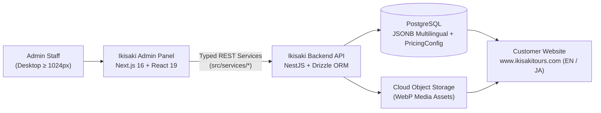

<div align="center">


<h1>Ikisaki Tours — Admin Panel</h1>

<p>
  <strong>Centralized Operations, Multilingual CMS &amp; Dynamic Pricing Dashboard for <a href="https://www.ikisakitours.com">www.ikisakitours.com</a></strong>
</p>

<p>
  <a href="https://nextjs.org/"></a>
  <a href="https://react.dev/"></a>
  <a href="https://www.typescriptlang.org/"></a>
  <br />
  <a href="https://tailwindcss.com/"></a>
  <a href="https://vercel.com/"></a>
</p>

<p>
  <a href="https://ikisakitours-admin-panel.vercel.app">Live Admin Panel</a> ·
  <a href="https://ikisakitours-admin-panel.vercel.app/manual">In-App Manual (<code>/manual</code>)</a> ·
  <a href="./admin-panel/ADMIN_MANUAL.md">Admin Operations Manual</a> ·
  <a href="./admin-panel/public/sample-packages">Sample JSON Templates</a>
</p>

</div>

---

## Table of Contents

- [Overview](#overview)
- [System Architecture](#system-architecture)
- [Module Directory (All 11 Groups)](#module-directory-all-11-groups)
- [Core Engineering Highlights](#core-engineering-highlights)
  - [1. Unified Dynamic Group Pricing (`pricingConfig`)](#1-unified-dynamic-group-pricing-pricingconfig)
  - [2. Multilingual `JSONB` CMS & Gold Title Highlighting](#2-multilingual-jsonb-cms--gold-title-highlighting)
  - [3. Strict WebP Media Pipeline & Brand Assets](#3-strict-webp-media-pipeline--brand-assets)
  - [4. Interactive In-App Operations Manual (`/manual`)](#4-interactive-in-app-operations-manual-manual)
- [API Service Layer Reference](#api-service-layer-reference)
- [Tech Stack](#tech-stack)
- [Project Structure](#project-structure)
- [Getting Started](#getting-started)
- [Deployment (Vercel)](#deployment-vercel)
- [Production Readiness Checklist](#production-readiness-checklist)
- [Credits & License](#credits--license)

---

## Overview

The **Ikisaki Tours Admin Panel** is a desktop-first enterprise operations platform powering **Ikisaki Tours** — a luxury Sri Lanka private tour operator serving international travelers with native **English (`EN`)** and **Japanese (`JA`)** localization plus extensible multi-language support.

From one centralized workspace, administrators manage fixed tour packages, industry-standard group discount tiers, passenger category rules, tour add-ons, day-by-day itineraries with dynamic meals & hotels, reusable destinations, customer bookings, custom service requests, registered user VIP/access controls, date availability calendars, blogs, FAQs, review moderation & admin replies, WebP media assets, legal compliance documents, and internal operations logs.

> [!TIP]
> **New to the dashboard?** Open the built-in interactive **[Admin Manual Guide (`/manual`)](https://ikisakitours-admin-panel.vercel.app/manual)** from the left sidebar, or read **[`admin-panel/ADMIN_MANUAL.md`](./admin-panel/ADMIN_MANUAL.md)** for step-by-step operational guides.

> [!IMPORTANT]
> **Desktop-Only Guardrail:** Complex pricing grids, multi-day itinerary builders, and calendar controls are protected by `DesktopOnlyGuard`. Always operate on a PC or laptop viewport (`≥ 1024px` recommended).

---

## System Architecture



---

## Module Directory (All 11 Groups)

| Group | Route(s) | Operational Capabilities |
| :--- | :--- | :--- |
| **Overview** | `/dashboard` | Monthly KPI cards (Visitors, Feed Impressions, Total Clicks, Avg. SEO Rank) + interactive Recharts `GrowthChart` |
| **Bookings & Operations** | `/tours`, `/tourservices` | One-Day / Multi-Day package booking statuses (`Pending`, `Confirmed`, `Completed`, `Cancelled`); tabbed service inquiries (`Custom Made Tours`, `Private Chauffeur`, `Transfers`) with status filters (`Pending`, `Approved`, `Active`, `Rejected`) |
| **User Management** | `/users` | Customer directory with total count badge and live **VIP**, **Active Access**, and **Verified** status toggles |
| **Tour Packages** | `/addpackage`, `/managepackages` | EN/JA/+ tour builder, 1-click JSON prefill, 18 conversion badges, Title + Gold Highlight rules, dynamic group pricing tiers, passenger rules, add-ons, dynamic meals/accommodation lists, Live Pricing Simulator, and text-only `PATCH` inline editing |
| **Destinations** | `/destinations`, `/managedestinations`, `/managedestinations/[id]/edit` | Reusable Sri Lanka destination hubs with JSON uploader, quick facts, multilingual content, media, and route sequencing |
| **Blog Articles** | `/blogs`, `/manageblogs`, `/manageblogs/[id]/edit` | Multilingual travel blog CMS with JSON importer, auto-slugify + custom slug override, and image uploader |
| **FAQs & Help** | `/faqs`, `/managefaqs`, `/managefaqs/[id]/edit` | Localized English & Japanese customer support Q&A management |
| **Availability & Rates** | `/newupdates`, `/servicepricing`, `/servicenotes` | Closed-date monthly calendar with tour-type closures & multilingual notes; 3-tab service pricing (`Charter`, `Custom`, `Transfer`); vehicle specs & multilingual service guidelines |
| **Media & Engagement** | `/imageupload`, `/comments`, `/contact` | Strict `.webp` batch uploader (max 4/batch); unified Website Feedback + Package Reviews moderation (visibility toggle + direct **Admin Replies**); Contact Us inquiry inbox |
| **Compliance & System** | `/legaldocs`, `/adminlogs` | Multilingual structured Legal Document CMS (Privacy Policy, Terms, sections & sub-items) and internal Admin Operations Log |
| **Help & Guide** | `/manual` | Modular, searchable in-app Admin Manual Guide with 1-click sample JSON downloads, interactive Pre-Publish Checklist, and Troubleshooting Accordion |

---

## Core Engineering Highlights

### 1. Unified Dynamic Group Pricing (`pricingConfig`)

Tour pricing aligns with real Sri Lanka private vehicle capacities and room-sharing economics:

| Tier | Min Pax | Max Pax | Sri Lanka Vehicle Class |
| :--- | :---: | :---: | :--- |
| **Solo** | `1` | `1` | Sedan Car (Prius / Axio) |
| **Couple** | `2` | `2` | Sedan Car (1 Double/Twin Room) |
| **Small Group** | `3` | `4` | Flat-Roof Van / Mini-Van (KDH / Noah) |
| **Medium Group** | `5` | `7` | High-Roof Van (Toyota KDH High Roof) |
| **Large Group** | `8` | `15` | Mini Coach (Mitsubishi Rosa / Coaster) |
| **Coach Group** *(Optional)* | `16` | `30+` | Full-Size Luxury Coach (33–45 Seater) |

- **Passenger Rules**: Couple (`auto_tier` or `fixed`), Child (`percentage` e.g. `50%` or `fixed`), Infant (default `$0`).
- **Tour Add-Ons**: Multilingual optional extras supporting `per_person`, `per_room`, and `per_booking` (one-time flat fee) billing modes inside the customer Booking Review Modal.
- **Built-in Simulator**: Interactive calculator embedded inside `/addpackage` and `/managepackages` to verify final totals before publishing.

<details>
<summary><strong>View Complete <code>pricingConfig</code> JSONB Schema Example</strong></summary>

```json
{
  "tiers": [
    { "minPax": 1, "maxPax": 1, "pricePerPerson": 850, "label": "Solo (1 Person)" },
    { "minPax": 2, "maxPax": 2, "pricePerPerson": 580, "label": "Couple (2 Persons)" },
    { "minPax": 3, "maxPax": 4, "pricePerPerson": 460, "label": "Small Group (3-4 Persons)" },
    { "minPax": 5, "maxPax": 7, "pricePerPerson": 390, "label": "Medium Group (5-7 Persons)" },
    { "minPax": 8, "maxPax": 15, "pricePerPerson": 320, "label": "Large Group (8-15 Persons)" }
  ],
  "passengerPricing": {
    "couplePricingType": "auto_tier",
    "coupleFixedPrice": 1160,
    "childRateType": "percentage",
    "childRateValue": 50,
    "infantPrice": 0
  },
  "options": [
    {
      "id": "opt-single-supplement",
      "name": { "en": "Single Room Accommodation Supplement", "ja": "シングルルーム（一人部屋）確約追加代金" },
      "price": 180,
      "calculationType": "per_room"
    },
    {
      "id": "opt-first-class-train",
      "name": { "en": "Scenic Blue Train 1st Class Ticket Upgrade", "ja": "絶景高原列車 1等指定席アップグレード" },
      "price": 25,
      "calculationType": "per_person"
    },
    {
      "id": "opt-vip-vehicle-upgrade",
      "name": { "en": "VIP Luxury Vehicle Upgrade (Alphard / Mercedes)", "ja": "VIPラグジュアリー車両アップグレード" },
      "price": 150,
      "calculationType": "per_booking"
    }
  ]
}
```

</details>

### 2. Multilingual `JSONB` CMS & Gold Title Highlighting

- All customer-facing text fields (`title`, `titleEmphasis`, `leadTitle`, `leadDescription`, `description`, `highlights`, `includes`, `excludes`, `activityDetails`, `itinerary`, dynamic `meals[]` & `accommodation[]`, add-ons, blogs, FAQs, legal docs, and closed-date notes) store ISO locale dictionaries (`{ "en": "...", "ja": "..." }`) with live `+` custom language extensibility.
- **Clean URL Slug Generation**: Auto-generated strictly from **Package Title (`EN`)** — updating Highlighted Words (`titleEmphasis`) never alters the URL slug.

> [!WARNING]
> **Japanese Highlight Matching Rule:** The customer website matches `titleEmphasis` character-for-character inside `title`. In Japanese, always use the exact same script (Kanji vs Katakana) in both fields — e.g., Title `究極のスリランカ・グランドエクスプローラー` → Highlight `究極のスリランカ`.

### 3. Strict WebP Media Pipeline & Brand Assets

- **Media Gallery (`/imageupload`)**: Enforces strict `.webp` format validation and a maximum batch size of **4 images per upload** (`POST /uploads/batch`) for optimal web performance.
- **Metadata, OpenGraph & Twitter Cards**: Configured in [`admin-panel/src/app/layout.tsx`](./admin-panel/src/app/layout.tsx) using optimized WebP brand assets from [`admin-panel/public/Layout-Icons/`](./admin-panel/public/Layout-Icons):
  - `favicon.ico`, `image-200x200.webp`, `image-400x400.webp`, `image-600x600.webp` (Icons & Apple Touch)
  - `image-1200x630.webp` & `image-600x315.webp` (OpenGraph & Twitter `summary_large_image`)
  - `robots: { index: false, follow: false }` to keep internal admin routes excluded from public search engines.

### 4. Interactive In-App Operations Manual (`/manual`)

Built as a modular, data-driven documentation hub inside [`admin-panel/src/app/manual/`](./admin-panel/src/app/manual):
- Centralized typed content store (`data/manualMockData.ts`) powering 11 focused React components
- Live full-text search across all 13 sections + hashtag quick-filter chips
- Direct 1-click downloads for One-Day and Multi-Day sample JSON templates
- Interactive Pre-Publish Checklist with live progress bar + expandable Troubleshooting Accordion

---

## API Service Layer Reference

All backend communication lives in strongly typed modules under [`admin-panel/src/services/`](./admin-panel/src/services):

| Service File | Primary Endpoint(s) | Purpose |
| :--- | :--- | :--- |
| `package.service.ts` | `/addpackages` (`GET`, `POST`, `PATCH`, `DELETE`) | Create packages (`FormData` + images), fetch by slug, text-only updates |
| `package-booking.service.ts` | `/package-bookings`, `/package-bookings/:id/status` | List fixed tour bookings, update status, delete |
| `tourservice.service.ts` | `/services/custom`, `/services/chauffeur`, `/services/transfer` | Manage tailor-made tour, chauffeur & transfer requests |
| `destination.service.ts` | `/destinations`, `/uploads/batch` | CRUD operations for Sri Lanka destination hubs |
| `blog.service.ts` | `/blogs`, `/uploads/batch` | Multilingual blog creation, editing & listing |
| `faq.service.ts` | `/faqs`, `/faqs/admin` | Multilingual FAQ CRUD management |
| `availability.service.ts` | `/availability` | Fetch & save closed booking dates and localized notes |
| `servicepricing.service.ts` | `/service-pricing` | Manage Charter, Custom Tour & Transfer rate cards |
| `service-notes.service.ts` | `/services/notes` | Manage vehicle specs & multilingual service guidelines |
| `uploads.service.ts` | `/uploads/batch` | Batch upload up to 4 `.webp` images to storage |
| `comments.service.ts` | `/comments`, `/comments/:id/reply`, `/comments/:id/visibility` | Website feedback replies & visibility toggles |
| `package-reviews.service.ts` | `/comments/package-reviews`, `/comments/package-review/:id/reply` | Package review replies & public visibility toggles |
| `contact.service.ts` | `/contacts`, `/contacts/:id` | Public Contact Us inquiry inbox & deletion |
| `users.service.ts` | `/auth/users`, `/auth/users/:id/status` | Customer listing & VIP / Access / Verified toggles |
| `legaldocs.service.ts` | `/legal-docs` | Multilingual Legal Document CMS CRUD |

---

## Tech Stack

| Layer | Technology |
| :--- | :--- |
| **Framework** | Next.js `16.2.10` (App Router, Turbopack, React Compiler) |
| **UI & Styling** | React `19.2`, Tailwind CSS `v4`, Shadcn / Base UI, Lucide React |
| **Language** | TypeScript `5.x` |
| **Charts** | Recharts `3.8` |
| **Utilities** | `exifr` (EXIF metadata), `clsx`, `tailwind-merge`, `class-variance-authority` |
| **Backend API** | NestJS + Drizzle ORM + PostgreSQL (`NEXT_PUBLIC_API_URL`) |

---

## Project Structure

<details>
<summary><strong>Click to expand repository directory tree</strong></summary>

```text
Ikisakitours-Admin-Panel/
├── README.md                              # Root GitHub documentation (GFM)
├── LICENSE
└── admin-panel/                           # Next.js 16 application workspace
    ├── ADMIN_MANUAL.md                    # Printable operations handbook (GFM)
    ├── public/
    │   ├── Layout-Icons/                  # Favicon, OG & Twitter WebP brand assets
    │   └── sample-packages/               # Ready-to-import EN/JA JSON templates
    │       ├── sample-oneday-tour.json
    │       └── sample-multiday-tour.json
    ├── src/
    │   ├── app/
    │   │   ├── layout.tsx                 # Root layout, Google Fonts, OG/Twitter metadata
    │   │   ├── dashboard/                 # Analytics KPI cards & GrowthChart
    │   │   ├── tours/                     # Fixed One-Day & Multi-Day bookings
    │   │   ├── tourservices/              # Custom tours, chauffeur & transfer requests
    │   │   ├── users/                     # Customer directory & VIP/Access controls
    │   │   ├── addpackage/                # Package wizard (JSON, pricing, itinerary)
    │   │   ├── managepackages/            # Package table & inline PATCH editor
    │   │   ├── destinations/              # Destination creator (JSON + Quick Facts)
    │   │   ├── managedestinations/        # Destination list & [id]/edit route
    │   │   ├── blogs/ & manageblogs/      # Multilingual blog CMS & [id]/edit route
    │   │   ├── faqs/ & managefaqs/        # Multilingual FAQ CMS & [id]/edit route
    │   │   ├── newupdates/                # Date Availability calendar & closure notes
    │   │   ├── servicepricing/            # Charter, Custom & Transfer rate cards
    │   │   ├── servicenotes/              # Vehicle specs & service guidelines
    │   │   ├── imageupload/               # Strict .webp gallery uploader (max 4/batch)
    │   │   ├── comments/                  # Feedback + Package Reviews & Admin Replies
    │   │   ├── contact/                   # Contact Us inquiries inbox
    │   │   ├── legaldocs/                 # Multilingual Legal Document CMS
    │   │   ├── adminlogs/                 # Internal daily Operations Log
    │   │   └── manual/                    # Interactive in-app Admin Manual Guide
    │   │       ├── page.tsx
    │   │       ├── data/manualMockData.ts # Centralized guide content store
    │   │       └── components/            # 11 modular React guide components
    │   ├── components/                    # Sidebar, DesktopOnlyGuard, Shadcn UI
    │   ├── lib/                           # API client fetcher & Tailwind utils
    │   └── services/                      # 15 typed REST API service modules
    ├── next.config.ts
    └── package.json
```

</details>

---

## Getting Started

### Prerequisites

- **Node.js** `>= 20.x`
- **npm** `>= 10.x`
- Access to the **Ikisaki Tours Backend API**

### 1. Clone & Install

```bash
git clone https://github.com/your-org/Ikisakitours-Admin-Panel.git
cd Ikisakitours-Admin-Panel/admin-panel
npm install
```

### 2. Configure Environment Variables

Create `admin-panel/.env.local`:

| Variable | Required | Description |
| :--- | :---: | :--- |
| `NEXT_PUBLIC_API_URL` | Yes | Base URL of the Ikisaki Tours NestJS Backend API |
| `NEXT_PUBLIC_ADMIN_API_KEY` | Yes | Admin API key for protected administrative endpoints |
| `NEXT_PUBLIC_SITE_URL` | Optional | Canonical admin panel URL used for OpenGraph & Twitter `metadataBase` |

```env
NEXT_PUBLIC_API_URL=https://ikisakitours-backend.vercel.app
NEXT_PUBLIC_ADMIN_API_KEY=your_admin_api_key_here
NEXT_PUBLIC_SITE_URL=https://ikisakitours-admin-panel.vercel.app
```

> [!CAUTION]
> Never commit `.env.local` or real API keys to version control. Always configure secrets securely in your deployment provider's environment settings.

### 3. Run, Type-Check & Build

```bash
# Start development server (http://localhost:3000)
npm run dev

# Run strict TypeScript type check
npx tsc --noEmit

# Run ESLint
npm run lint

# Build & run production server
npm run build
npm run start
```

---

## Deployment (Vercel)

1. Import the repository into **Vercel**.
2. Set **Root Directory** to `admin-panel`.
3. Add `NEXT_PUBLIC_API_URL`, `NEXT_PUBLIC_ADMIN_API_KEY`, and `NEXT_PUBLIC_SITE_URL` under **Settings → Environment Variables**.
4. Deploy — Vercel builds all 26 App Router routes cleanly with Turbopack.

---

## Production Readiness Checklist

- [x] Next.js `16.2.10` (Turbopack) production build verified (`26/26` routes, `0` errors, `0` warnings)
- [x] OpenGraph, Twitter Cards, Favicons & `noindex` robots metadata configured via `public/Layout-Icons/`
- [x] Unused starter SVG assets, empty directories, and duplicate lockfiles cleaned up
- [x] Unified `pricingConfig` (Group Discount Tiers + Passenger Rules + Add-Ons) live
- [x] Dynamic `meals[]` & `accommodation[]` itinerary arrays supported
- [x] Modular in-app **Admin Manual Guide (`/manual`)** integrated into Sidebar

---

## Credits & License

| Attribute | Details |
| :--- | :--- |
| **Client & Owner** | **Ikisaki Tours (Pvt) Ltd** — [www.ikisakitours.com](https://www.ikisakitours.com) |
| **Powered By** | **Aetheria Labs** |
| **Engineered By** | **Shehan_W** & **Pramod_Siriwardhana** |
| **License** | All rights reserved © 2026 Ikisaki Tours (Pvt) Ltd |

> [!IMPORTANT]
> **Proprietary Software Notice:** This application and its source code are private, proprietary assets built exclusively for the internal operations of **Ikisaki Tours (Pvt) Ltd**. Unauthorized copying, modification, redistribution, or commercial use of any part of this repository without prior written consent is strictly prohibited.

> [!NOTE]
> **Copyright © 2026 Ikisaki Tours (Pvt) Ltd. All rights reserved.**  
> This repository and its source code, design assets, and localization dictionaries are proprietary and confidential. Unauthorized copying, redistribution, modification, or commercial use is strictly prohibited without prior written consent from Ikisaki Tours (Pvt) Ltd. See [`LICENSE`](./LICENSE) for full terms.
---

<div align="center">

**© 2026 Ikisaki Tours (Pvt) Ltd** · Powered by **Aetheria Labs** · Engineered by **Shehan_W** & **Pramod_Siriwardhana**

</div>
