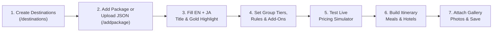

# Ikisaki Tours — Admin Panel Operations Manual

> [!NOTE]
> This is the official operational handbook for **Ikisaki Tours** administrators (`www.ikisakitours.com`).  
> An interactive, searchable version of this guide with live checklists and 1-click JSON template downloads is also available directly inside the dashboard at **`/manual`** (via **Sidebar → Help & Guide → Admin Manual Guide**).

---

## Table of Contents

- [1. System Requirements & Navigation](#1-system-requirements--navigation)
- [2. Dashboard & Platform Analytics (`/dashboard`)](#2-dashboard--platform-analytics-dashboard)
- [3. Bookings & Tour Services (`/tours`, `/tourservices`)](#3-bookings--tour-services-tours-tourservices)
- [4. Creating & Managing Tour Packages (`/addpackage`, `/managepackages`)](#4-creating--managing-tour-packages-addpackage-managepackages)
  - [4.1 Multilingual Switcher (`EN` / `JA` / `+`)](#41-multilingual-switcher-en--ja--)
  - [4.2 Fast Creation with JSON Import](#42-fast-creation-with-json-import)
  - [4.3 Titles, Gold Highlighting & URL Slug Rules](#43-titles-gold-highlighting--url-slug-rules)
  - [4.4 Dynamic Group Discount Tiers & Vehicle Guide](#44-dynamic-group-discount-tiers--vehicle-guide)
  - [4.5 Passenger Category Rules & Tour Add-Ons](#45-passenger-category-rules--tour-add-ons)
  - [4.6 Day-by-Day Itinerary, Dynamic Meals, Hotels & Gallery](#46-day-by-day-itinerary-dynamic-meals-hotels--gallery)
  - [4.7 Editing Live Packages Safely (`/managepackages`)](#47-editing-live-packages-safely-managepackages)
- [5. Destinations Management (`/destinations`, `/managedestinations`)](#5-destinations-management-destinations-managedestinations)
- [6. Blog Articles & FAQs (`/blogs`, `/manageblogs`, `/faqs`, `/managefaqs`)](#6-blog-articles--faqs-blogs-manageblogs-faqs-managefaqs)
- [7. Date Availability, Service Pricing & Guidelines (`/newupdates`, `/servicepricing`, `/servicenotes`)](#7-date-availability-service-pricing--guidelines-newupdates-servicepricing-servicenotes)
- [8. Users, Media Gallery, Reviews & Contact (`/users`, `/imageupload`, `/comments`, `/contact`)](#8-users-media-gallery-reviews--contact-users-imageupload-comments-contact)
- [9. Legal Documents & Operations Log (`/legaldocs`, `/adminlogs`)](#9-legal-documents--operations-log-legaldocs-adminlogs)
- [10. Pre-Publish Tour Checklist](#10-pre-publish-tour-checklist)
- [11. Common Issues & Troubleshooting](#11-common-issues--troubleshooting)

---

## 1. System Requirements & Navigation

> [!IMPORTANT]
> **Desktop-Only Requirement:** The Admin Panel enforces `DesktopOnlyGuard`. Always operate on a PC or laptop with a viewport width of **`≥ 1024px`** to prevent accidental edits on complex pricing grids and itineraries.

- **Hover Sidebar:** The dark left navigation rail stays compact (`IT` logo) and smoothly expands on mouse hover, revealing all **11 module groups**.
- **Recommended Browsers:** Latest Google Chrome, Microsoft Edge, Safari, or Firefox.

---

## 2. Dashboard & Platform Analytics (`/dashboard`)

- **Month Picker:** Switch between reporting months in the top-right dropdown.
- **KPI Cards:** Monitor **Total Visitors**, **Feed Impressions**, **Total Clicks**, and **Avg. SEO Position** (`#` rank change).
- **Daily Growth Chart:** Hover over any day in the Recharts line/area chart to inspect traffic spikes and high-demand windows.

---

## 3. Bookings & Tour Services (`/tours`, `/tourservices`)

### Fixed Tour Bookings (`/tours`)
- Lists direct reservations submitted from published **One-Day** and **Multi-Day** tour pages.
- Use **Filter By** (`All Fixed Packages`, `One-Day Tours`, `Multi-Day Tours`) to sort requests.
- Inspect client details, journey date, and exact traveler breakdown (`Adults`, `Couples`, `Children`, `Infants`).
- Update booking status live via the color-coded selector: `Pending` · `Confirmed` · `Completed` · `Cancelled`.

### Tour Services (`/tourservices`)
- Organized into 3 tabs: **Custom Made Tours**, **Private Chauffeur**, and **Transfers**.
- Filter leads by status: `All` · `Pending` · `Approved` · `Active` · `Rejected`.

> [!TIP]
> After confirming a peak-season booking, block unavailable fleet dates in **`/newupdates`** and record chauffeur/guide allocations inside **`/adminlogs`**.

---

## 4. Creating & Managing Tour Packages (`/addpackage`, `/managepackages`)

### Recommended Tour Publishing Workflow



### 4.1 Multilingual Switcher (`EN` / `JA` / `+`)
1. Fill in **English (`EN`)** first (required fields).
2. Click **`JA`** in the top bar and translate all localized fields into Japanese.
3. Click **`+`** to add any additional 2-letter ISO language code (`fr`, `de`, `es`, `zh`).

### 4.2 Fast Creation with JSON Import
1. Download a template from [`public/sample-packages/`](./public/sample-packages) (or directly from the `/manual` sidebar):
   - `sample-oneday-tour.json`
   - `sample-multiday-tour.json`
2. Customize the fields (ensure `slug` is unique) and drop it into the **JSON Uploader** at the top of `/addpackage`.
3. Manually attach **Gallery Images** (JSON cannot embed binary photos) and click **Save Package**.

### 4.3 Titles, Gold Highlighting & URL Slug Rules

| Field | Behavior & Best Practice |
| :--- | :--- |
| **Package Title (Title 1)** | Full tour name (e.g., `The Ultimate Sri Lanka Grand Explorer`). |
| **Highlighted Words in Title (Title 2)** | Exact substring inside Title 1 to render in **Gold Italic** on the website (e.g., `Ultimate Sri Lanka`). |
| **URL Slug (Auto)** | Auto-generated **strictly from English Title 1** (e.g., `the-ultimate-sri-lanka-grand-explorer`). Changing Title 2 never modifies the slug. |
| **Badge** | Choose from 18 conversion badges (`Best Seller`, `Top Rated`, `All-Inclusive Package`, `Instant Confirmation`, `UNESCO Heritage Explorer`, etc.). |

> [!WARNING]
> **Japanese Highlight Rule (Kanji vs Katakana):**  
> Highlighting matches exact characters inside Title 1. Always copy the exact Japanese substring directly from Title 1!  
> - **Correct:** Title = `究極のスリランカ・グランドエクスプローラー` → Highlight = `究極のスリランカ` (Highlights in Gold!)  
> - **Incorrect:** Title = `究極のスリランカ...` → Highlight = `アルティメット・スリランカ` (Kanji ≠ Katakana → No highlight!)

### 4.4 Dynamic Group Discount Tiers & Vehicle Guide

| Tier Label | Min Pax | Max Pax | Sri Lanka Vehicle Class | Cost Economics |
| :--- | :---: | :---: | :--- | :--- |
| **Solo (1 Person)** | `1` | `1` | Sedan Car (Prius / Axio) | 1 guest covers 100% of vehicle & guide cost |
| **Couple (2 Persons)** | `2` | `2` | Sedan Car (1 Double Room) | Fixed vehicle/guide costs split by 2 (~35–40% drop) |
| **Small Group (3–4 Persons)** | `3` | `4` | Flat-Roof Van (KDH / Noah) | Ideal for small groups with luggage |
| **Medium Group (5–7 Persons)** | `5` | `7` | High-Roof Van (Toyota KDH) | 9-seater layout with suitcase space |
| **Large Group (8–15 Persons)** | `8` | `15` | Mini Coach (Rosa / Coaster) | Covers 8–15 pax; next custom tier starts at `16` |
| **Coach Group (16–30+)** *(Optional)* | `16` | `30` | Luxury Tour Coach (33–45 Seater) | Corporate & large family groups |

> [!CAUTION]
> **Zero Gaps & Zero Overlaps Rule:**  
> Each tier's **Min Pax** must equal the previous tier's **Max Pax + 1** (e.g., `1–1`, `2–2`, `3–4`, `5–7`, `8–15`, `16–30`). Leaving a gap causes travelers in that gap to fall back to the Solo (highest) rate!

### 4.5 Passenger Category Rules & Tour Add-Ons

- **Couple (2 Adults):** Counts as 2 paying guests toward Group Tiers. Use `Auto (2 × Active Tier)` so couples in larger groups receive group discounts, or set a `Fixed` pair rate.
- **Child (Age 2–12):** Default `50%` of the active adult tier rate (or set a `Fixed` USD fee).
- **Infant (Under 2):** Keep at `$0` for free lap travel, or set a fee for baby car-seat rental.

| Add-On Type | Code | How It Calculates | Examples |
| :--- | :--- | :--- | :--- |
| **Per Person** | `per_person` | `Price × Guest Quantity` (capped at total guests) | 1st Class Train Upgrade, Ayurveda Spa, Yala VIP Jeep |
| **Per Room** | `per_room` | `Price × Selected Rooms` | Single Room Supplement, Extra Bed |
| **Per Booking** | `per_booking` | **One-time flat fee** (single checkbox) | VIP Luxury Van Upgrade, Private Photographer & Drone |

> [!TIP]
> Always verify every rate combination using the **Live Pricing Preview Simulator** at the bottom of the Pricing section before saving.

### 4.6 Day-by-Day Itinerary, Dynamic Meals, Hotels & Gallery

- **Dynamic Meals (`+ Add Meal`):** Add each meal as its own line so guests clearly see inclusions & exclusions (e.g., `Breakfast Included`, `Lunch Not Included`, `Gourmet Dinner Included`).
- **Dynamic Accommodation (`+ Add Accommodation`):** List one or more hotel options per overnight stay (e.g., `Heritance Kandalama (5-Star)`, `Aliya Resort & Spa (4-Star)`). Each entry renders with its own gold icon on the website.
- **Route Flow, Locations, Scenic Stops & Activities:** Fill in EN and JA for clean arrow-connected route pills and timelines.
- **Gallery Images:** At least **1 high-resolution landscape photo** is mandatory for new packages (recommended `< 2MB`, WebP/JPG).

### 4.7 Editing Live Packages Safely (`/managepackages`)
Click **Edit** on any package row to modify text, badges, pricing tiers, add-ons, or itineraries via safe text-only **`PATCH`** updates without overwriting existing gallery images.

---

## 5. Destinations Management (`/destinations`, `/managedestinations`)

- Create destinations in `/destinations` **before** linking them inside the Tour Package Destination Sequence Picker.
- Supports **DestinationJsonUploader**, Basic Info, Quick Facts, Multilingual Content (`EN`/`JA`), and Media.
- Edit published destinations anytime at `/managedestinations` → **Edit** (`/managedestinations/[id]/edit`).

---

## 6. Blog Articles & FAQs (`/blogs`, `/manageblogs`, `/faqs`, `/managefaqs`)

### How to Add & Manage Blog Articles (`/blogs`, `/manageblogs`)
1. Open **`/blogs`** (optionally upload `sample-blog.json` via `JsonImporter`).
2. In the **EN** tab, fill in **Title** (auto-generates URL Slug), **Author**, **Category**, **Read Time**, **Summary**, and full **Blog** body.
3. Switch to **JA** (or click **`+`** to add another ISO language) and translate all fields.
4. Attach cover photos via `ImageUploader` and click **Save**.
5. Edit or delete published articles anytime at **`/manageblogs`** → **Edit** (`/manageblogs/[id]/edit`).

### How to Add & Manage FAQs (`/faqs`, `/managefaqs`)
1. Open **`/faqs`** and start in the **English (`EN`)** tab.
2. Fill in **Category** (e.g., `Booking & Payments`, `Airport Pickup`), **Question**, and **Answer**.
3. Switch to the **JA** tab (or click **`+`** for custom languages) and enter the Japanese Category, Question, and Answer.
4. Click **Create FAQ** — the form resets and the new FAQ appears immediately below.
5. To edit or delete later, open **`/managefaqs`** → **Edit** (`/managefaqs/[id]/edit`) or **Delete**.

---

## 7. Date Availability, Service Pricing & Guidelines (`/newupdates`, `/servicepricing`, `/servicenotes`)

- **How to Block / Open Dates (`/newupdates`):**
  1. Choose the Month/Year on the calendar and click any date.
  2. In `DateConfigPanel`, select which Tour Types are closed on that date.
  3. Add multilingual closure notes (`EN` / `JA` / `+`) explaining the reason (e.g. `Fully Booked`).
  4. Verify `ClosedDatesList` and click **Save Changes**.
- **Service Pricing (`/servicepricing`):** Switch across 3 tabs (**Charter Service Rates**, **Custom Tour Pricing**, **Transfer Rates**), edit localized `EN`/`JA`/`+` rates, and click **Save Changes**.
- **Service Guidelines (`/servicenotes`):** Select Service Type (`custom`, `chauffeur`, `transfer`), configure Vehicle Type, Starting Price, Passenger & Luggage Capacity, Driver/Guide/Driver+Guide rates, and `EN`/`JA` policy bullet notes.

---

## 8. Users, Media Gallery, Reviews & Contact (`/users`, `/imageupload`, `/comments`, `/contact`)

### How to Manage Registered Users (`/users`)
1. Open **`/users`** to view the **Total Users** counter and customer cards.
2. **Toggle Access (`Active` ↔ `Blocked`):** Click the top-right Access badge on a user card to suspend or restore account access.
3. **Toggle VIP (`👑`):** Click the VIP button to award or remove VIP Member status (adds a gold Crown badge to their avatar).
4. **Toggle Verified (`✓`):** Click Verified to add or remove the blue verified checkmark.
5. **View User UUID:** Click the **Eye icon** on any card to reveal or hide the internal User ID for support lookups.

### Media Gallery (`/imageupload`)
> [!IMPORTANT]
> **Strict Upload Rules:** `/imageupload` accepts **`.webp` files ONLY** and a maximum of **4 images per batch**. Convert JPG/PNG files to `.webp` before staging.

### Reviews & Feedback (`/comments`) & Contact Inbox (`/contact`)
- **Reviews (`/comments`):** Filter by `All Types`, `Website Feedback`, `Package Review`, or **`By Not Responded`**; toggle public visibility; and post official **Admin Replies** beneath customer reviews.
- **Contact (`/contact`):** Read public Contact Us submissions and delete resolved/spam entries.

---

## 9. Legal Policies & Admin Operations Log (`/legaldocs`, `/adminlogs`)

### How to Add & Edit Legal Policy Documents (`/legaldocs`)
1. Open **`/legaldocs`** and click **New Document** in the left `DocumentSidebar` to open the **New Policy Document** modal.
2. Enter **Document Title** (e.g., `Cancellation Policy`) — the unique **Document ID** auto-generates (`cancellation-policy`). Set **Eyebrow** (`Legal & Compliance`), **Accent Color**, and **Last Updated** date, then create.
3. Select the document in the sidebar and click **`+ Add Section`** to add ordered clauses (**Heading**, **Content**, and nested **Sub-Items**).
4. Switch the top language switcher from **EN** to **JA** (or click **`+`**) and translate Title, Eyebrow, Sections, and Sub-Items.
5. Click **Save Changes** to publish live to the website footer legal pages.

### How to Record Daily Operations Logs (`/adminlogs`)
1. Open **`/adminlogs`** and select a **Log Type**: `👤 Allocation`, `📅 Schedule`, `⚠️ Issue / Alert`, or `📝 General Note`.
2. Optionally add a **Request ID** (e.g., `req_1`) and **Assigned Staff** (e.g., `Saman (Driver)`).
3. Enter your operational note and submit to append it to the live team timeline.

---

## 10. JSON Structure Templates & AI Content Generator Workflow

Every JSON-importable module in the Admin Panel has a ready-to-download template in [`public/sample-packages/`](./public/sample-packages) (and inside **`/manual` → Section 12** with 1-click Copy & AI Prompts):

| Template File | Module | Upload Route |
| :--- | :--- | :--- |
| `sample-oneday-tour.json` | One-Day Tour Packages | `/addpackage` |
| `sample-multiday-tour.json` | Multi-Day Tour Packages | `/addpackage` |
| `sample-destination.json` | Sri Lanka Destinations | `/destinations` |
| `sample-blog.json` | Multilingual Blog Articles | `/blogs` |

> [!TIP]
> **Using AI (ChatGPT / Gemini / Claude) to Generate JSON Files:**  
> 1. Open **`/manual` → Section 12 (JSON Templates & AI Prompts)** inside the Admin Panel.  
> 2. Click **Download `.json`** (or **Copy JSON**) for the module you need.  
> 3. Click **Copy AI Prompt** for Tour Package, Destination, or Blog, paste it into your AI tool together with the JSON structure and your rough notes (English, Sinhala, or Japanese).  
> 4. Save the AI's raw JSON output as a `.json` file, upload it into the Admin Panel's JSON Uploader, attach your photos manually, and click **Save**.

---

## 11. Pre-Publish Tour Checklist

- [ ] Both **English (`EN`)** and **Japanese (`JA`)** tabs are completely translated.
- [ ] **Highlighted Words (Title 2)** matches exact characters inside **Package Title (Title 1)** in *both* `EN` and `JA`.
- [ ] **URL Slug** is clean, readable, and unique.
- [ ] **Group Discount Tiers** have **zero gaps** and **zero overlaps**.
- [ ] Verified final totals in the **Live Pricing Preview Simulator**.
- [ ] Added explicit dynamic **Meals** and **Accommodation** items per itinerary day.
- [ ] Attached **Destinations** in chronological route order.
- [ ] Selected at least **1 high-resolution landscape Gallery Image**.

---

## 12. Common Issues & Troubleshooting

| Issue | Module | Root Cause | Solution |
| :--- | :--- | :--- | :--- |
| **`500 Error` / `packages_slug_unique`** | Tour Packages | Another tour already uses the exact same URL slug. | Slightly modify English **Package Title (Title 1)** for a unique slug, or edit the existing tour in `/managepackages`. |
| **Japanese title has no Gold Highlight** | Tour Packages | Kanji vs Katakana mismatch between Title 1 and Title 2. | Copy the exact Japanese substring directly from Title 1 into Highlighted Words (Title 2). |
| **Save Package blocked while on `JA` tab** | Tour Packages | Core English (`EN`) required fields are empty. | Switch back to the **`EN`** tab, fill all required English fields, attach images, and save. |
| **No gallery upload in `/managepackages`** | Tour Packages | `/managepackages` uses text-only `PATCH` to protect existing photos. | Use `/managepackages` for text/pricing/itinerary edits and `/addpackage` for new photo uploads. |
| **Sudden Solo price jump for 3–4 or 5–7 guests** | Dynamic Pricing | A gap exists between `Max Pax` of one tier and `Min Pax` of the next. | Edit tiers in `/managepackages` so every `next.minPax === prev.maxPax + 1`. |
| **`Invalid JSON file format` error** | Media & JSON | AI output included ```` ```json ```` backticks, extra text, or `.txt` extension. | Ensure the file starts with `{`, ends with `}`, has no markdown fences, and ends in `.json`. |
| **`Please select at least one gallery image`** | Media & JSON | JSON import fills text/pricing only — never image binaries. | Attach at least 1 tour photo manually in the Gallery section before saving. |
| **Media Gallery rejects uploaded files** | Media & JSON | Non-WebP format (`.jpg`/`.png`) or more than 4 files selected. | Convert images to **`.webp`** and upload at most **4 images per batch**. |
| **Wrong Hero image on Destination page** | Media & JSON | Index 0 (first photo, ★ Hero) is used as the main banner (max 6 photos). | Clear staged photos and select your main Hero landscape photo **first**. |
| **Blocked dates still open on website** | Availability | Clicking dates stages local changes until **Save Changes** is clicked. | Review `ClosedDatesList`, click **Save Changes**, and wait for confirmation. |
| **Legal Doc `ID already in use` / lost edits** | Legal Docs | Duplicate policy Document ID or unsaved editor changes. | Choose a unique Title/ID, check **Live Preview**, and click **Save** before leaving. |
| **`401/403` error or `Desktop Screen Required`** | System & Auth | Missing API key, backend cold start (3–5s), or narrow viewport (`< 768px`). | Wait 5s & refresh for cold starts; verify `.env.local` keys; open on desktop (`≥ 1024px`). |

---

## 13. November 19, 2026 Operational Upgrades (from 07:45 AM onwards)

### 13.1 Universal 1-Click Live Visibility Toggle
- **Modules Covered:** Tour Packages (`/managepackages`), Blog Articles (`/manageblogs`), Destinations (`/managedestinations`), and FAQs (`/managefaqs`).
- **Functionality:** 
  - Allows operations staff to instantly toggle any item between **Live on Site** (Emerald badge) and **Hidden / Draft** (Slate badge) with a single click.
  - Public website queries automatically filter `WHERE isLive = true`, preventing unfinished drafts or seasonal tours from appearing to guests or search engines.
  - Each module features an **All Visibility** dropdown filter (`All Visibility`, `Live on Site`, `Hidden / Drafts`) to inspect active vs staged inventory.

### 13.2 Edit-Mode Image Upload Isolation
- **Modules Covered:** Edit Destination (`/managedestinations/[id]/edit`) and Edit Blog (`/manageblogs/[id]/edit`).
- **Behavior:** The file upload input is now automatically hidden during edit mode via `hideImageUpload={true}`.
- **Why:** The backend update endpoints (`PATCH /destinations/:id` and `PATCH /blogs/:id`) process JSON metadata updates only. Hiding the file picker prevents accidental re-upload attempts and guarantees existing Cloudflare R2 photos remain uncorrupted.

### 13.3 Clean Overview-First Data Tables & Compact Search
- **Standardized Search Bar:** Compact width across all management modules (`w-full sm:w-64 lg:w-72 shrink-0`) aligned with the Reviews page design.
- **Tour Services (`/tourservices`):** Route & schedule details are concise; Airport/Intercity transfers display *"Awaiting Quote (Distance Based)"* instead of $0; Service Notes vehicle dropdowns right-aligned.
- **Reviews & Feedback (`/comments`):** Distinct handling for Website Feedback vs Tour Package reviews; official industry-standard staff reply presets.
- **Contact Inquiries (`/contact`):** Truncated messages prevent horizontal layout blowout; Inquiry Type column pulled cleanly to the left.

### 13.4 Unified Luxury Delete Modal (`AdminDeleteModal`) & Dynamic Toasts (`AdminToast`)
- **Centered Top Warning Icon:** Reusable delete modal with item preview card and loading spinner, preventing layout distortion.
- **Dynamic Width Toast:** Auto-adjusts width to notification content (`min-w-[240px]` up to `max-w-md` with `break-words`).

### 13.5 Zero Trust Enterprise Admin Authentication & Edge Route Guard
- **Edge Route Guard Protection (`src/proxy.ts` / `middleware.ts`):** Automatically blocks any unauthenticated direct URL visits and redirects to `/login?redirect=...`.
- **Light Luxury Login Portal (`/login`):** Fully integrated into the light luxury theme of the admin panel (`bg-slate-50`, crisp white cards, 256-bit encryption badge).
- **Dedicated Sign Out:** Accessible anytime from the bottom of the hover sidebar.
- **Initial Super Admin Seeding (`npm run seed:admin`):**
  - Run in the backend repository: `npm run seed:admin` to provision the primary Super Admin.
  - Reads `INITIAL_ADMIN_EMAIL` and `INITIAL_ADMIN_PASSWORD` from `.env`.
  - Default development credentials: `admin@ikisakitours.com` / `IkisakiAdmin2026!`.
- **Supabase Database Row Level Security (RLS):**
  - In the Supabase SQL Editor migration warning, always select **`Run and enable RLS`**.
  - Prevents public client keys (`anon`) from accessing `admin_users` or `admin_sessions`, while the NestJS server connects directly via PostgreSQL pool credentials with full privileges.
- **Brute Force Lockout:** 5 consecutive incorrect attempts automatically locks the account for 30 minutes (HTTP 429).

---

*Maintained by **Aetheria Labs** for **Ikisaki Tours** (`www.ikisakitours.com`).*
